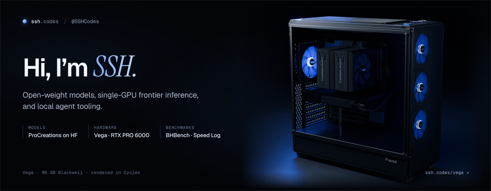
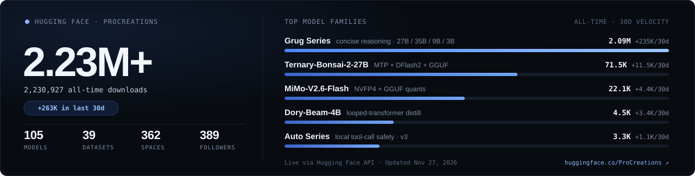

<a href="https://ssh.codes/vega">
  <picture>
    <source media="(prefers-reduced-motion: reduce)" srcset="assets/vega-hero.png">
    
  </picture>
</a>

  <a href="https://ssh.codes"><strong>ssh.codes</strong></a> &nbsp;·&nbsp;
  <a href="https://huggingface.co/ProCreations"><strong>Hugging Face</strong></a> &nbsp;·&nbsp;
  <a href="https://bhbench2.ssh.codes"><strong>BHBench 2.0</strong></a> &nbsp;·&nbsp;
  <a href="https://optimizing.ssh.codes"><strong>Speed Log</strong></a> &nbsp;·&nbsp;
  <a href="https://x.com/SSHCodes"><strong>X</strong></a> &nbsp;·&nbsp;
  <a href="mailto:me@ssh.codes"><strong>me@ssh.codes</strong></a>

<a href="https://huggingface.co/ProCreations">
  <picture>
    <source media="(prefers-color-scheme: dark)" srcset="https://raw.githubusercontent.com/SSHdotCodes/SSHdotCodes/output/hf-stats-dark.svg">
    <source media="(prefers-color-scheme: light)" srcset="https://raw.githubusercontent.com/SSHdotCodes/SSHdotCodes/output/hf-stats-light.svg">
    
  </picture>
</a>

### Open-weight models

- **[The Grug Series](https://huggingface.co/ProCreations)** — Concise-reasoning models (`27B`, `35B`, `9B`, `3B` + GGUF / QAT / MTP) trained to think in short notes (94–98% fewer thinking tokens) and answer in normal English. **2.09M+ downloads.**
- **[Auto v3](https://github.com/SSHdotCodes/auto)** — Local tool-call permission classifiers (`auto-3b-3`, `auto-0.4b-3`, `auto-150m-3`, 64K context) for Claude Code, Codex, Gemini CLI, Cursor, Pi, OpenCode, and Hermes.
- **[Nadir](https://github.com/SSHdotCodes/nadir)** — 16M-parameter on-device model that designs per-site dark mode inside Chromium via `onnxruntime-web` (WASM).
- **Speculative heads, quants & distills** — [Ternary-Bonsai-2-27B MTP / DFlash2](https://huggingface.co/ProCreations/Ternary-Bonsai-2-27B-MTP), [MiMo-V2.6-Flash NVFP4](https://huggingface.co/ProCreations/MiMo-V2.6-Flash-RL-NVFP4), [Dory-Beam-4B](https://huggingface.co/ProCreations/Dory-Beam-4B), [Nib 4B](https://huggingface.co/ProCreations/nib-4b-preview), and [DSpine](https://github.com/SSHdotCodes/dspine-trainer).

### Single-GPU frontier inference

Serving 300B–510 GB models on **[Vega](https://ssh.codes/vega)** (1× RTX PRO 6000 Blackwell 96 GB + 128 GB DDR5). Every optimization is tracked on the [Speed Log](https://optimizing.ssh.codes).

| Model | Decode | Context | Stack |
| :--- | :--- | :--- | :--- |
| **[Qwen3.8-Flash-Next](https://github.com/SSHdotCodes/qwen-3.8-flash-next-pro6000)** | **303.8 tok/s** | 262K | SGLang, custom CUDA decode kernels, W4A16 routed experts, exact speculative rejection sampling |
| **[MiMo-V2.6-Flash (310B)](https://github.com/SSHdotCodes/mimo-v2.6-flash-pro6000)** | **77.0 tok/s** | 524K | Exact NVFP4, DFlash speculative decoding, VRAM/RAM expert residency |
| **[GLM-5.3-Flash (320B)](https://github.com/SSHdotCodes/glm-5.3-flash-pro6000)** | **61–68 tok/s** | 512K | EXL3 3.05bpw, custom GPU expert cache over pinned RAM, native vision |
| **[DeepSeek-V4.1-Flash (510 GB)](https://github.com/SSHdotCodes/deepseek-v4.1-flash-pro6000)** | **31.6 tok/s** native · **49.1** k3 | 1M | `ds41d` custom engine with VRAM/RAM/NVMe expert tiers + GPUDirect Storage |

### Agent tooling, benchmarks & builds

| Project | What it is |
| :--- | :--- |
| **[BetterWright](https://github.com/BetterWright/betterwright)** | Persistent, policy-guarded Playwright browser for AI agents (credential vault, network policy, proof screenshots) + [BetterWright-4b](https://huggingface.co/ProCreations/BetterWright-4b). |
| **[Second Opinion](https://github.com/SSHdotCodes/second-opinion)** | MCP multi-agent orchestration — run and steer Claude Code, Codex, Grok, and OpenCode as parallel worker teams. |
| **[SSHCode](https://github.com/SSHdotCodes/sshcode)** & **[T3Code RPC](https://github.com/SSHdotCodes/t3code-rpc)** | Desktop/phone harness for coding agents on your own subscriptions (T3 Code fork) + animated Discord Rich Presence. |
| **[BHBench](https://bhbench.ssh.codes)** & **[BHBench 2.0](https://bhbench2.ssh.codes)** | 41-model real-time C++ black-hole benchmark ([source](https://github.com/SSHdotCodes/bhbench)), plus BHBench 2.0 where frontier models write CUDA renderers on Vega and export up to 8K60 films. |
| **[AI Change Radar](https://live.aitracker.bot)** | Polls 75 first-party AI vendor sources every 20s and broadcasts live model releases via Discord and [@aitrackerbot](https://x.com/aitrackerbot). |
| **[Tutori](https://github.com/SSHdotCodes/tutori)** | Agentic voice tutor that teaches by drawing live on a continuous whiteboard. |
| **[Videopaper](https://github.com/SSHdotCodes/Videopaper)** | Native macOS live wallpapers, including a real-time ray-traced black hole in Metal. |
